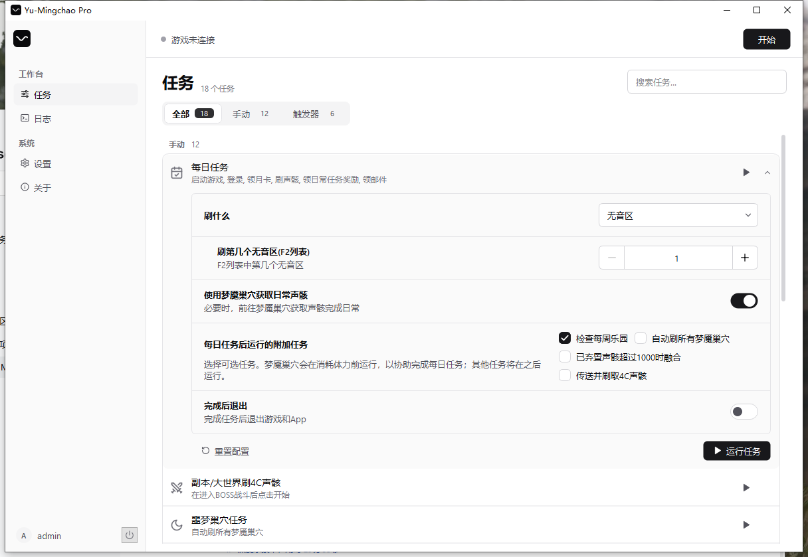
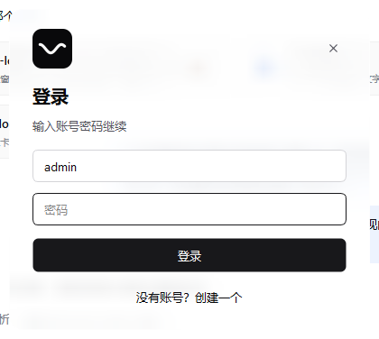
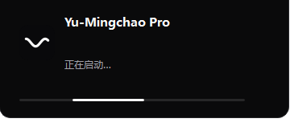

# Yu-Mingchao Pro

> 一个基于**图像识别**的《鸣潮》（Wuthering Waves）自动化工具，从 [ok-ww](https://github.com/ok-oldking/ok-wuthering-waves) 二次开发而来。
> 通过模拟键鼠操作与屏幕识别工作：**不读内存、不改游戏文件**。

本仓库是「我自己的版本」：沿用 ok-ww 的识别素材、任务框架与角色逻辑，在外层换成自己的品牌、
自己的配置目录、自己的启动方式和后续要做的功能。



<sub>登录（首次启动会引导创建本地账号）：</sub>



---

## ⚠️ 先看这里

1. 上游 **ok-ww 使用 AGPL-3.0 许可**。这意味着：你可以自用、可以改，但**一旦分发（发安装包、放网上、提供服务），
   必须继续以 AGPL-3.0 开源你的完整代码，并保留原作者署名**。详见 [LICENSE.txt](LICENSE.txt) 与 [CREDITS.md](CREDITS.md)。
2. 本工具属于第三方辅助，**存在账号被封的风险**。请自行判断是否使用。
3. 仅供个人学习（Python / 计算机视觉 / UI 自动化），**请勿商用或收费**。

---

## 🚀 快速开始

三个入口，按需要选：

| 入口 | 行为 |
| --- | --- |
| **桌面快捷方式 `Yu-Mingchao Pro`** / `start-silent.vbs` | **无控制台窗口**，直接出界面（和官方安装版一样） |
| `start.bat` | 带控制台启动，能看到实时日志，**排查问题、看报错用这个** |
| `start.ps1` | 带参数的启动（自动跑任务、跑完退出等） |

首次启动会先弹**登录框**：没有账号时提示「创建账号」，账号密码保存在本地
`configs/accounts.json`（PBKDF2 加盐哈希，不存明文）。之后每次启动都要登录，
侧边栏底部可以「退出登录」。

`start.bat` 会自动：

1. 检查 `.venv`（Python 3.12 虚拟环境），没有就创建；
2. 首次运行时安装 `requirements.txt` 里的依赖（约 1 GB，只装一次）；
3. 启动 `main.py`（GUI 主程序）。

> 关于那个黑窗口：`start.bat` 调用的是 `python.exe`（带控制台），黑窗口里滚的是程序日志，
> 不是报错。快捷方式用的是 `pythonw.exe`，所以不会出现。
> 完整日志始终会写到 `logs/ok-script.log`，界面「日志」页也能看。

命令行用法：

```powershell
# 普通启动
.\start.bat

# 调试模式（带更多日志/PyCharm 友好）
.\start.bat -Debug

# 启动后自动执行任务列表里第 1 个任务，跑完退出
.\start.ps1 -Task 1 -Exit

# 直接用解释器（开发时推荐）
.\.venv\Scripts\python.exe main.py
```

> 注意：本机没装系统 Python 时，`.venv` 是用内置 Python 3.12 建的。若换机器，请先装 Python 3.12，
> `start.bat` 会自动找到 `py -3.12` 或 `python`。

---

## 🗂 目录结构

```
yu-mingchao-pro/
├─ start.bat                 一键启动（带控制台，调试用）
├─ start-silent.vbs          无窗口启动（双击出界面）
├─ start.ps1                 带参数的启动脚本
├─ main.py                   正式入口 → OK(config).start()
├─ main_debug.py             调试入口
├─ config.py                 全局配置：标题/图标/日志/任务注册/窗口与识别参数
├─ icons/                    应用图标（icon.png / icon.ico，已换成自己的）
├─ assets/                   识别素材（模板图、声骸模型等）
├─ ok_templates/             模板编辑器的源图与标注（改识别素材时用）
├─ i18n/                     翻译（gettext，zh_CN / zh_TW / ja_JP / ko_KR / es_ES）
├─ src/
│  ├─ task/                  自动化任务（一键日常、刷声骸、自动战斗…）
│  ├─ char/                  角色自动战斗逻辑（每个角色一个文件）
│  ├─ combat/                战斗判定
│  ├─ scene/                 游戏场景状态（是否在队伍/大世界）
│  ├─ gui/                   自定义界面页（队伍码、多账号配置）
│  ├─ globals.py             全局对象（YOLO 模型等）
│  └─ game_launcher.py       游戏启动/参数
├─ tests/                    单元测试（.\\run_tests.ps1）
├─ app_ui/                   自己的应用外壳：窗口 / 侧边栏 / 状态条 / 日志页 / 设置页 / 磨砂玻璃
│  └─ motion.py              动效组件：自绘按钮、导航、窗口淡入、高度动画
├─ auth/                     本地账号系统：存储（PBKDF2）+ 登录框 + 门禁
├─ ui_theme/shadcn.py        shadcn 风格主题覆盖层（色板/字体/圆角/自绘选中态）
├─ ui/                       自己的任务页、关于页、页面替换入口 install.py
├─ dev_preview.py            界面预览入口（不影响正式实例，方便改 UI）
├─ tools/make_icon.py        生成自有应用图标
├─ tools/make_icons.py       生成 Lucide 线性图标集
├─ configs/                  运行时配置（首次启动生成，已 gitignore）
└─ logs/ok-script.log        运行日志
```

## 🎨 界面：shadcn 风格

上游 ok-ww 的界面是 ok-script 自带的那套 Qt 组件库。本项目在**不改依赖包**的前提下，
用 `ui_theme/shadcn.py` 在运行时把它覆盖成 shadcn/ui 的视觉语言：

| 维度 | 上游原样 | 本项目 |
| --- | --- | --- |
| 色板 | 紫/蓝强调色 + 偏灰背景 | zinc 中性色 + **反色 primary**（浅色近黑、深色近白） |
| 控件底色 | 有明显边框和填充 | `#FFF/#FAFAFA` 平面，1px `#E4E4E7` 细边 |
| 圆角 | 12/10/8px 混用 | 卡片 12px、按钮/输入框 6px（rounded-xl / rounded-md） |
| 选中态 | 强调色半透明块 + 描边 | muted 色块 `#F4F4F5`，无描边（Sidebar / 任务行 / Tab） |
| Tabs | 白色轨道 + 灰 pill | muted 轨道 + 白色 pill（shadcn Tabs） |
| 图标 | 彩色游戏风 PNG | **Lucide 线性图标**，统一 `#71717A` 描边 |
| 毛玻璃 | Mica / Acrylic | 关闭，纯色平面 |
| 深色模式 | 有 | 有，且 primary 自动反色（白底黑字） |

三个和主题相关的开关：

```python
# config.py
'ui_style': 'shadcn',      # 改成 'default' 就回到上游原样式
```

- **切换浅色/深色**：软件里「设置 → 外观」，或直接改 `configs/ui_config.json` 的 `theme`（`light` / `dark` / `auto`）。
- **改主题色**：`ui_theme/shadcn.py` 顶部的 `LIGHT` / `DARK` 两个色板。
- **预览改动**：`.\.venv\Scripts\python.exe dev_preview.py` —— 独立进程 + 独立配置，不会和正在跑的实例打架。
- **还原图标**：`icons/tasks/original/` 里是原始彩色 PNG，拷回上一级即可；
  重新生成线性图标用 `tools/make_icons.py`（可改 `MAPPING` 换图标）。

### 应用外壳（`app_ui/`）—— 不再是 ok-ww 的界面

ok-script 的窗口（`KitWindow` + `NavigationView` + `RunBar`）整套被替换掉：启动时
`ui/install.py` 把 `MainWindow` 类换成 `app_ui.window.AppWindow`，所以进程里根本没有
ok-ww 的侧边栏、标题栏、运行条。

### 启动流程（`app_ui/splash.py` + `app_ui/prelude.py`）

ok-script 的初始化是同步的（导入、设备、OCR、18 个任务），这段时间屏幕上什么都没有，
所以先出启动画面，再初始化：

```
双击 → 0.2~0.3s 出现启动画面（logo + 正在启动…）
     → 初始化完成（设备 / OCR / 任务注册）
     → 启动画面淡出 → 登录框
     → 登录通过 → 主窗口淡入
```

- `prelude.bootstrap()`：先建 QApplication、**先把启动画面显示出来并 processEvents**，
  再导入 `ok` 包（替换掉 ok-script 里会重复创建 QApplication 的 `init_app_config`）。
- 启动画面是**真正的读条**：按阶段推进（加载组件 6% → 加载引擎 40% → 初始化界面 58%
  → 初始化设备与识别 66% → 准备就绪 100%），每段用 `processEvents()` 小步插值，
  所以没有事件循环时读条也是平滑走过去的。
- 启动画面最短展示 700ms（`YMP_SPLASH_MIN_MS` 可调），避免一闪而过。
- 主窗口的两个「重页面」延迟构建：**设置页**首次点开才建（含全部全局配置表单）、
  **任务页**首帧不展开任何任务（展开会当场构建整套设置表单）。

实测（本机热启动，进程内计时）：启动画面 ~0.24s、登录框 ~0.6s、登录后主窗口 ~+0.4s。



### 登录入场动效（磨砂玻璃 + 若隐若现）

登录卡是**真实的磨砂玻璃**（pp_ui/frosted.py）：Qt Widgets 没有原生背景模糊，
所以启动最早期（还没显示任何窗口时）先截一张屏幕，缩放两次做近似高斯模糊，
登录卡按自己的位置裁一块当玻璃底，再叠 80% 的半透明着色 + 顶部高光 + 1px 描边。

入场是「缩放缓浮起 + 长时间淡入 + 迟到的高光」三层，整体 0.5s 左右，慢到能看清：

| 层 | 参数 |
| --- | --- |
| 缩放 | 卡片从 95.5% 浮起到 100%（460ms OutQuint） |
| 淡入 | 卡片透明度 0 → 1（520ms OutCubic）——所以是「若隐若现」而不是一闪 |
| 高光 | 淡入进行到 45% 时开始扫过（900ms OutCubic） |

登录里的交互细节：

- **启动画面 → 登录卡交叉过渡**：先撑满启动画面最短展示时间，然后同时开始「登录卡浮起」和「启动画面淡出」，中间没有空档。
- **悬停有渐变**：按钮背景、文字色、描边一起插值（190ms OutCubic），不是瞬间变色。
- **键盘可达**：按钮可获得焦点并显示焦点环；账号框回车跳到密码，密码/确认框回车直接登录。
- **密码错误**：卡片轻微横向抖动（380ms，5 次衰减），比只弹一行红字更醒目。
- **慢放调试**：YMP_ANIM_SLOW=6 把入场动效放慢 6 倍，方便观察。
- **登录成功 → 主界面**：登录卡先**收成一条 2px 的线**（170ms InCubic），
  主窗口在背后就绪后，再由一层置顶 overlay 用「遮罩反向开洞」把这条线撑成整窗（420ms OutCubic），
  看起来就是「缝里展开」。详见 pp_ui/morph.py。
- **没有「先闪一块白底」**：登录窗口自身底色置空（palette + WA_NoSystemBackground），
  入场动画推迟一个事件循环——第一帧一定是「窗口不可见 + 卡片透明」，
  等系统合成完成后再打开窗口做淡入。
- **不会在左上角闪一下**：登录框/启动画面/主窗口都在 `show()` 之前摆到屏幕中央，并且首帧整体透明度为 0
  （Windows 创建原生窗口时可能先在默认位置露一帧），定位完成后再打开。

卡片**不交给布局管理**（手动 setGeometry），才能安全地做几何动画；窗口本身不淡入、
也不移动，避免 Windows 原生窗口合成抖动。`YMP_ANIM_SLOW=6` 可把入场动效放慢 6 倍方便观察。

```
┌───────────┬──────────────────────────────────────────────┐
│ 品牌区     │ 状态条：● 游戏状态 · 当前任务 · 开始/暂停/停止  │
│           ├──────────────────────────────────────────────┤
│ 任务      │                                              │
│ 日志      │              页面内容                         │
│ 设置      │                                              │
│ 关于      │                                              │
└───────────┴──────────────────────────────────────────────┘
```

| 页面 | 实现 | 说明 |
| --- | --- | --- |
| 任务 | `ui/tasks.py` | **单列手风琴**：标题 + 搜索 + 分段筛选（全部/手动/触发器），点一行就地展开设置与运行按钮，不再是「左列表 + 右详情」 |
| 日志 | `app_ui/log_page.py` | 实时 tail `logs/ok-script.log`，支持关键字过滤、暂停、打开目录 |
| 设置 | `app_ui/settings_page.py` | 外观（跟随系统/浅色/深色）+ 全局配置分节（基本选项、角色、快捷键、月卡、通知） |
| 关于 | `ui/about.py` | 极简 logo + 名称版本 + 两行免责声明 + GitHub/常见问题；没有「相关项目」、没有「更新检查」、不写「基于 xxx 开发」 |

品牌处理：窗口标题只出现一次应用名；侧边栏只放 logo 标记（不重复名称/版本），版本号只在「关于」里出现。

### 账号系统（`auth/`）

启动先登录，未通过就退出，不进入主界面。

| 文件 | 作用 |
| --- | --- |
| `auth/store.py` | `AuthStore`：`configs/accounts.json` + PBKDF2-SHA256 加盐哈希（24 万次迭代）；`session` 保存当前登录用户 |
| `auth/dialog.py` | 无边框登录框：首次引导创建账号，之后登录；回车提交、Esc 关闭、可拖动 |
| `ui/install.py` | 在 `App.show_main_window` 前插入登录门禁 |

**后续接服务器**：保持 `has_users()` / `create()` / `verify()` 三个方法不变，把 `AuthStore`
换成请求你服务器的实现即可，界面层不用改。

### 动效（`app_ui/motion.py`）

Qt Widgets 没有 CSS transition，官方动画机制就是 `QPropertyAnimation` / `QParallelAnimationGroup`
（qfluentwidgets 这类库底层也是它）。这里用它们做了两层：

| 场景 | 动效 | 时长 / 曲线 |
| --- | --- | --- |
| 启动 → 登录 | 启动画面淡出 **与** 登录卡浮起交叉进行 | 200ms / 460ms |
| 登录成功 | 登录框淡出 → 主窗口淡入 | 160ms / 200ms |
| 切换页面 | 内容横向滑入 18px（只移动控件，不整页重绘） | 180ms OutQuint |
| 按钮 hover | 背景 + 文字色 + 描边一起插值 | 190ms OutCubic |
| 按钮按下 | 压暗 → 回弹 | 110ms |
| 侧边栏选中 | 选中块颜色插值 | 160ms |
| 任务行 hover | 背景块淡入 | 150ms |
| 任务行展开/收起 | 高度 + 内容淡入（动画组并行） | 260ms OutQuart |

几个关键取舍：

- **不动窗口位置**：移动原生窗口会触发 Windows 重排合成，低端显卡上明显抖
- **页面切换不用整页透明度**：`QGraphicsOpacityEffect` 每帧把整页渲染成位图，1200×800 上会掉帧、文字发虚；改成平移 + 裁剪
- **展开动画用 `QParallelAnimationGroup`**：高度和内容透明度和同时跑，收尾统一清理 effect

想再往上，就得把外壳换成 **Qt Quick（QML）**——GPU 合成、`Behavior on`/`NumberAnimation` 是真正的声明式动画；
Qt Widgets 这套是 CPU 光栅，能调顺，但上限有限。

窗口行为：原生标题栏、单实例、关闭即退出；`YMP_START_PAGE=settings|log|about`
可直接打开指定页（开发/截图用）；`dev_preview.py` 用独立配置目录，不影响正式实例。

### 与框架的边界

| 保留 ok-script 的 | 自己写的 |
| --- | --- |
| 任务引擎 `TaskExecutor`、启动流程 `StartController`、配置 `Config`/`ConfigOption`、设备捕获与输入、OCR | 窗口外壳、状态条、侧边栏、任务页、日志页、设置页、关于页、登录与账号、主题（`ui_theme/shadcn.py`）、应用图标 |

**暂时没有的**（框架窗口原本附带，重写时被去掉，后续按需补）：

- 系统托盘图标与托盘菜单
- 「计划任务」页面（Windows 任务计划里的调度仍然存在，只是没有 UI）
- 语言切换下拉框（界面文字目前固定中文）
- 新版提示 / 更新检查（本来也已被关闭）

## 🧩 相比上游 ok-ww 改了什么

| 位置 | 改动 |
| --- | --- |
| `config.py` | `APP_NAME`/`APP_ID`、`version`、`gui_title`、日志路径、`about` 文案、`links` 换成自己的 |
| `config.py` | **关掉了上游 `update_pyappify` 自更新**，否则启动会把你的版本替换回 ok-ww 官方版 |
| `config.py` | 新增 `ui_style`，用于切换 shadcn / 原样式 |
| `icons/icon.png` / `icon.ico` | 换成极简图标（黑色圆角 + 白色波浪线），原图留档为 `icon-upstream.*` |
| `icons/tasks/*.svg` | 25 个任务/分类图标换成 Lucide 线性图标（原彩色 PNG 在 `original/`） |
| `ui_theme/shadcn.py` | shadcn 主题覆盖层（色板、字体、圆角、选中态自绘、关毛玻璃） |
| `app_ui/window.py` | **全新应用外壳**（品牌标记/侧边栏/状态条/页面栈/账号区），不再用 ok-ww 的窗口 |
| `app_ui/log_page.py` / `app_ui/settings_page.py` | 自写日志页、设置页 |
| `auth/` | 本地账号系统 + 登录门禁（可替换为服务器校验） |
| `ui/tasks.py` / `ui/about.py` / `ui/install.py` | 手风琴任务页、关于页，以及类替换/门禁机制 |
| `pyproject.toml` / `setup.py` / `pyappify.yml` | 包名、作者、站点、更新仓库指向自己的占位地址 |
| `start.bat` / `start.ps1` / `start-silent.vbs` / `dev_preview.py` | 一键启动、无窗口启动、界面预览 |
| `README.md` / `CREDITS.md` | 自述与 AGPL 署名 |

**没改**：`src/` 下的任务、角色、识别逻辑，`assets/`、`i18n/` 全部保持上游实现——所有自动化能力原样可用。

---

## 🛠 继续定制（下一步常做的 4 件事）

1. **改名字/文案**：`config.py` 顶部的 `APP_NAME`、`APP_ID`，以及 `about`、`links`。
2. **换图标**：改 `tools/make_icon.py` 里的配色/文字，然后
   `.\.venv\Scripts\python.exe tools\make_icon.py`。
3. **加自己的任务**：在 `src/task/` 新建一个继承 `BaseWWTask`（一次性）或 `TriggerTask`（触发器）的类，
   再到 `config.py` 的 `onetime_tasks` / `trigger_tasks` 里注册。参考 `src/task/AutoPickTask.py`（最短的触发器例子）。
4. **发布自己的安装包**：填好 `pyappify.yml` 的 `git_url`，用 `pyappify` 打包；或者直接把整个目录压缩分发
   （记得遵守 AGPL：附源码与许可）。

开发环境与测试：

```powershell
.\.venv\Scripts\python.exe -m pip install ".[dev]" --upgrade   # 测试依赖
.\run_tests.ps1                                                # 跑测试
```

---

## ❓常见问题（沿用上游经验）

- **杀软误报**：把安装目录加入 Windows Defender / 杀软白名单。
- **识别不准**：关闭 Auto HDR、显卡滤镜（RTX HDR、AMD 锐化）、以及帧率叠加层（MSI Afterburner 等）；
  使用游戏默认亮度；帧率尽量稳定 60 FPS。
- **改了游戏按键**：到设置里同步改「Game Hotkey」。
- **自动战斗不攻击**：队伍里每个角色都要装备**主声骸**（右下角要有声骸技能图标）。
- **游戏断线**：设置里开启「启动后关闭启动器」。

## 📄 许可与致谢

本项目基于 **ok-ww**（作者 ok-oldking，AGPL-3.0）二次开发，遵循 AGPL-3.0 发布。
识别素材、任务与角色逻辑的版权归原作者及贡献者所有，详见 [CREDITS.md](CREDITS.md)。
